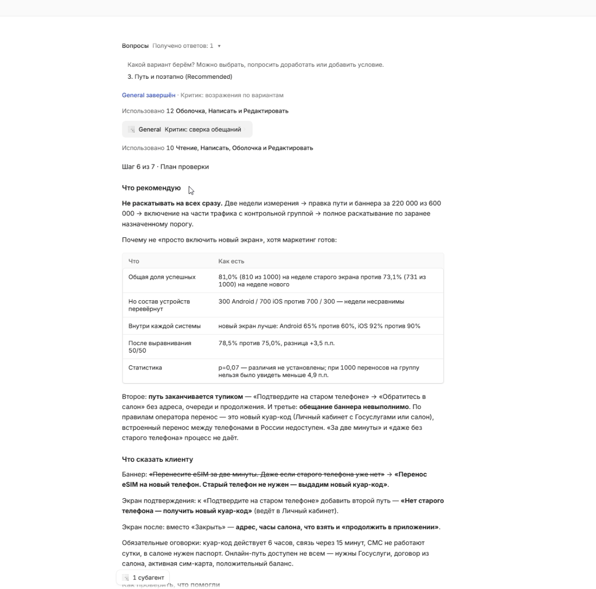

# Стратег Фабрики продуктов

ИИ-агент для руководителя цифрового продукта. Получает запрос и рабочие материалы, сравнивает варианты, готовит продуктовую и коммуникационную стратегии. Руководитель выбирает решение и видит, какие данные могут его изменить.

**[Посмотреть демопроект eSIM](submission/esim/README.md)** · **[Описание со скриншотами (PDF)](submission/overview.pdf)** · **[Все проверки и ответы моделей](benchmarks/README.md)** · **[Скачать комплект для жюри](submission/for-jury.zip)**

## Решение, которое меняет одна таблица

В демонстрационном кейсе маркетинг готов раскатить новый экран переноса eSIM. По общему итогу успешных переносов стало меньше: **73,1% против 81,0%**. Однако в первую неделю большинство клиентов пользовались iOS, во вторую — Android. Внутри Android результат вырос с 60% до 65%, внутри iOS — с 90% до 92%. При одинаковом составе устройств разница меняет знак: **+3,5 процентного пункта**. Сравнение двух календарных недель оставляет открытым вопрос, помог ли сам экран.

Для руководителя это меняет действие: отложить массовый запуск, проверить причины отказов и сравнить экраны одновременно. Для клиента — убрать из баннера обещание переноса «за две минуты», пока время не подтверждено. На входе было семь файлов; на выходе можно отдельно прочитать решение для директора, план изменений и текст для клиента. [Исходные материалы](submission/esim/materials) · [Сводка](submission/esim/outputs/0-svodka.md) · [Продуктовая стратегия](submission/esim/outputs/3-produktovaya-strategiya.md) · [Коммуникационная стратегия](submission/esim/outputs/4-kommunikacionnaya-strategiya.md)

<b>Посмотреть, как решение выглядит в живом диалоге</b>

В отдельном прогоне DeepSeek руководитель выбрал поэтапную проверку пакета за 220 000 ₽. На кадре видны выбор и расчёт. Выше доступны документы прогона, в котором руководитель выбрал сначала собрать причины отказов.

[Кадр после уточнения условий запуска](submission/screens/revision.png)

## Что можно проверить за три минуты

| Возможность | Наблюдаемый результат | Открыть |
|---|---|---|
| Работа с разными источниками | В новом кейсе библиотеки Cursor извлёк из PDF показатель «выдано за 48 часов», разобрал обращения, интервью и запись экрана. После удаления повтора осталось 3 обращения, в 2 из них истёк код. | [Картина ситуации](submission/cursor/1-kartina-situacii.md) |
| Проверяемые основания | Для метрики сохранён фрагмент исходного PDF. В отдельном тесте строку RFC 1035 сверили с повторно скачанным оригиналом издателя. | [Метрика](submission/library/trace.json) · [Сверка оригинала](submission/library/source-check.json) |
| Продолжение и пересмотр | В учебном сценарии библиотека узнала, что разделить поток до дедлайна нельзя. Сравнение поставлено на паузу, 4 000 ₽ остаются в бюджете. Экран показывает прежнее решение, новое и изменённый план. | [Скачать экран «Было → стало»](submission/library/change.html?raw=1) |
| Материалы для совещания | Один расчёт опубликован в редактируемой книге с формулами, шестистраничной записке и слайдах. В книге есть модели экономики, когорт, роста и рынка; учебные финансовые сценарии подписаны отдельно. | [Excel](submission/library/Модель.xlsx) · [PDF](submission/library/Записка.pdf) · [PowerPoint](submission/library/Презентация.pptx) |
| Выбор моделей и учёт расходов | Доступны готовый режим, свой маршрут и учёт за действие, задачу или сессию. В библиотечном тесте OpenCode подтвердил исследование на DeepSeek и критику на Hy4. Именно эти две успешные операции стоили $0 по журналу хоста. | [Ответ на выбор своего маршрута](benchmarks/megafon-esim/claude-sessions/v21-b73ffac7-custom.md) · [Квитанции](submission/library/host-receipts.json) |

## Что показали испытания

| Проверка | Результат | Доказательства |
|---|---|---|
| **66 автоматических тестов** | Проверяют происхождение фактов, отзыв выводов, развилки, выбор моделей, учёт, обработку файлов, дубли и календарь. | [Код и протокол по каждому тесту](benchmarks/README.md#автоматические-тесты) |
| **Claude: обычный чат и агент** | На eSIM первая пара дала **18/20 у обоих**. В следующем сравнении обычный чат получил **9/20**, агент v12 — **19/20**. Сохранены ответы обеих сторон и разбор по критериям. | [Первая пара](benchmarks/megafon-esim/claude-v10/score.md) · [Вторая пара](benchmarks/megafon-esim/claude-v12/score.md) |
| **Claude: повторяемость** | Три чистые сессии v16 с одинаковыми файлами и запросом: **20, 19 и 19 из 20** за первый ответ. Время — 48–62 секунды на ответ, суммарно $0,39542 по OpenCode. | [Все три оценки и замечания](benchmarks/megafon-esim/claude-repeatability/score.md) · [21 сохранённый журнал, включая отладку](benchmarks/megafon-esim/claude-sessions/README.md) |
| **DeepSeek: восстановление после обрыва** | После исчерпания баланса сессия продолжилась на бесплатной модели. Итог и документы получили **20/20** по шкале кейса. Независимая перепроверка модели в этой попытке прервалась. | [Диалог](benchmarks/megafon-esim/deepseek-v10/dialog.md) · [Оценка и ограничения](benchmarks/megafon-esim/deepseek-v10/score.md) |
| **Cursor: перенос на новый кейс** | Те же семь типов материалов, другой продукт. Агент дошёл до выбора варианта. Лимит Cursor остановил прогон перед финальным решением. | [Варианты](submission/cursor/2-varianty.md) · [Статус](submission/cursor/status.txt) · [Сохранённый проект](submission/cursor/resume-project.zip) |

Баллы в таблице выставлены автором по десяти критериям учебного eSIM-кейса. Кейс использовался при разработке. Первые ответы и сквозные прогоны оценивались отдельно. В каталоге также есть контрольные аудио с шумом, русский диалог, MP4 с кодом только в кадре, исходники таблиц и задания для самостоятельной проверки. [Каталог испытаний](benchmarks/README.md)

## Запуск на своём кейсе

1. Скачайте [чистую сборку](submission/strateg-agent.zip), распакуйте и откройте **strateg-agent** как проект в OpenCode (Build), Claude Code или Cursor. Проверьте окружение командой `strateg.cmd doctor` в Windows или `./strateg doctor` в macOS/Linux.
2. Опишите решение своими словами и приложите материалы. Для пробы в сборке есть семь файлов библиотеки. Пример запроса: «Посмотри materials/library-case. Как улучшить выдачу книг за три недели и что показать директору?»
3. Выберите режим и способ учёта. Подтвердите задачу, затем выберите вариант. Итоговые документы появятся в `projects/<имя>/outputs/`. Чтобы вернуться после перерыва, откройте новый чат в той же папке и напишите «Продолжай».

Для PDF нужен `pypdf`. Для локального разбора аудио и видео установите зависимости из [requirements-media.txt](requirements-media.txt), для экспорта документов — из [requirements-committee.txt](requirements-committee.txt). Модели предоставляет выбранная среда.

[Правила агента](AGENTS.md) · [Маршрутизация](docs/execution.md) · [Расчёты](docs/calculations.md) · [Как проверять материалы](docs/media-and-web.md)
